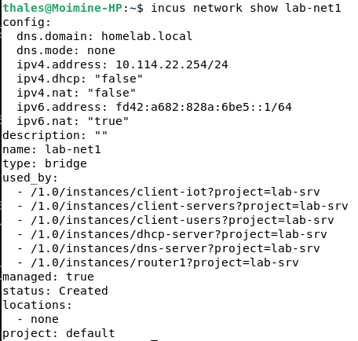
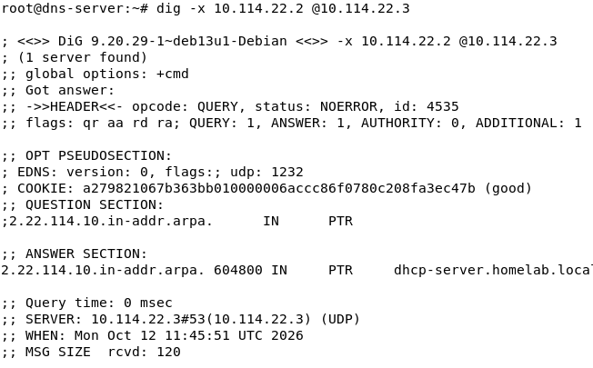
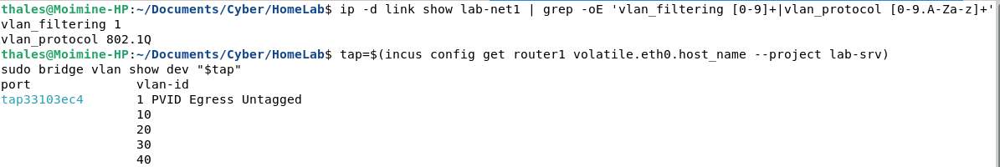
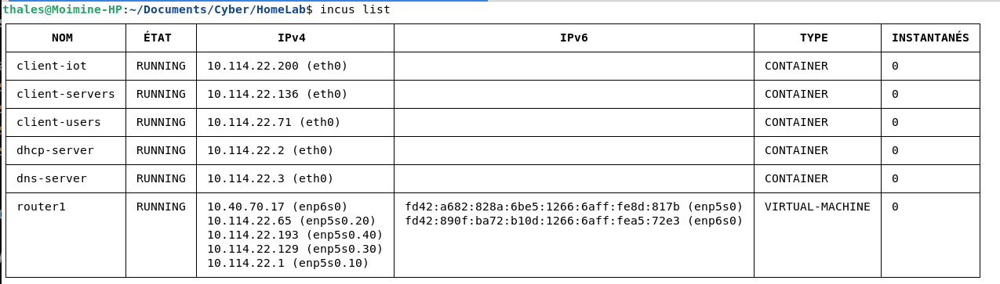
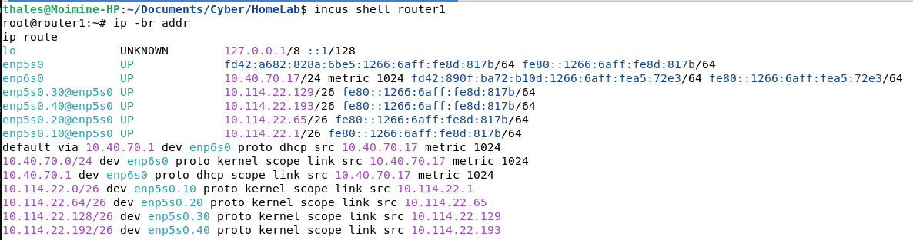
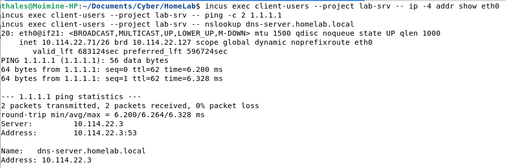
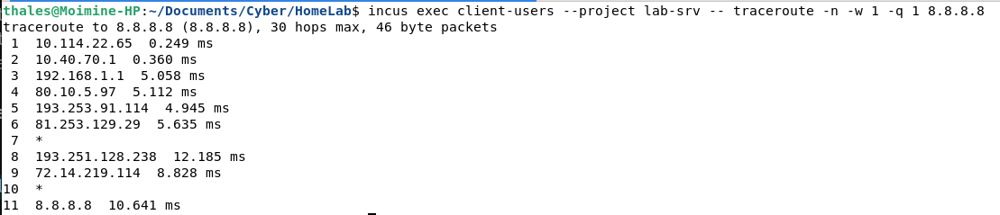

# Network & Cybersecurity Homelab

Network, virtualization & cybersecurity homelab: DHCP, DNS, routing, VLAN segmentation, firewall, Active Directory, IDS/SIEM, built step by step from scratch.

## Summary

- [x] [Phase 0 - Setup](#phase-0--setup)
- [x] [Phase 1 - First virtual network](#phase-1--first-virtual-network)
- [x] [Phase 2 - Network servers (DHCP/DNS)](#phase-2--network-servers)
- [x] [Phase 3 — Routing and VLAN Segmentation](#phase-3--routing-and-vlan-segmentation)
- [ ] [Phase 4 - Firewall](#phase-4--firewall)
- [ ] [Phase 5 - Active Directory](#phase-5--active-directory)
- [ ] [Phase 6 - Cyber Blue Team (detection)](#phase-6--cyber-blue-team-detection)
- [ ] [Phase 7 - Cyber Red Team (attack)](#phase-7--cyber-red-team-attack)
- [ ] [Phase 8 - Moving to real hardware](#phase-9--moving-to-real-hardware)
- [ ] [Phase 9 - HID injection](#phase-10--hid-injection)

---

# Phase 0 - Setup

**Goal:** understand the environment before building anything.

**Tools and hardware:** Debian PC, Incus, Wireshark, tcpdump, systemd-networkd, systemd-resolved.

## Step 0.1 - Understanding the host machine

Basic exploration of the host's network configuration: interface, IP address, gateway, DNS.

**What I observed and understood:**
- The difference between the network address (`.0`), the broadcast address (the last address of the block, `.255` for a `/24`), and the usable host addresses.
- Name resolution goes through `systemd-resolved`, which forwards requests to whichever DNS server is configured.
- The gateway is usually, by convention, the first address of the network (`.1`) - but that's just a convention, not a rule.
- The difference between a `scope link` route (directly reachable local network) and a `via` route (reachable through a gateway).

Key commands:
```bash
ip address show
ip route show
resolvectl status
```


## Step 0.2 - Understanding Incus

**Goal:** get familiar with Incus's core concepts before creating any instance.

**Installation and initialization:**
```bash
apt install incus
incus admin init
```

**Concepts covered:**
- **Storage pool vs storage volume** : the pool is the total physical space available to all instances; a volume is the portion of that space dedicated to a specific instance.
- **Profile** : a reusable configuration template, applied to one or more instances to avoid repeating the same settings on every creation.
- **Project** : an isolation space, used to keep groups of instances, networks, and profiles separate within a single Incus host.
- **Network** : a managed bridge that instances connect to in order to communicate with each other and the outside world. By default, `incus admin init` creates one such bridge (`incusbr0`), used automatically unless another network is specified.
- **Built-in network stack** : Incus runs a `dnsmasq` service by default, acting as both DHCP and DNS server on every network it creates.
- **Hypervisor** : Incus VMs run on KVM, the Linux kernel's native hypervisor.

**Commands used to explore these concepts:**
```bash
incus storage list
incus project list
incus network list
incus profile list
```
Storage list :


Network list :


---

# Phase 1 - First virtual network

**Goal:** understand how machines communicate with each other.

## Step 1.1 - Create a network

```text
Name   : lab-net
Subnet : 10.10.1.0/24
```

## Step 1.2 - First container (`debian1`)

```bash
incus shell debian1
ip a
```


## Step 1.3 - Second container (`debian2`)

```bash
incus shell debian2
ip a
```


## Observations: DHCP, DNS, ARP, ICMP and NAT

### DHCP

- Exchange between the DHCP server (`dnsmasq`, built into Incus) and the machines on `lab-net`, for IP address assignment following the DORA cycle: Discover, Offer, Request, Acknowledge.
- The protocol uses two UDP ports:
  - port 67 (`bootps`): the **server** listens here (receives Discover and Request);
  - port 68 (`bootpc`): the **client** listens here (receives Offer and Acknowledge).

```bash
sudo tcpdump -i lab-net port 67 or port 68 -vvv
```


### DNS

- Name resolution, required to reach the internet.
- Distinction between the local resolver (the `systemd-resolved` stub) and authoritative/recursive DNS servers.
- The protocol uses port 53: UDP by default, TCP for larger responses and zone transfers.

```bash
nslookup google.com
host google.com
dig google.com
```

### ARP

- Capturing ARP frames (`who-has` / `is-at`) between two test containers.
- Different behavior between `arping` and `ping` regarding the kernel's neighbor cache: `arping` stays strictly at layer 2 and doesn't update the neighbor cache, while `ping` triggers a normal ARP resolution and creates a `REACHABLE` entry.

```bash
incus exec debian1 -- arping -c 2 debian2
incus exec debian1 -- ip neigh show
```


After these exchanges, each machine caches its peer's MAC address:


### ICMP

- ICMP Echo Request / Echo Reply sequences.
- The `Destination Host Unreachable` case, generated locally when ARP resolution fails.
- How TTL works, and how `traceroute` makes use of it.

```bash
incus exec debian1 -- ping debian2
```


```bash
incus exec debian1 -- ip route
incus exec debian1 -- traceroute debian2
incus exec debian1 -- traceroute google.com
```


### NAT

- Address translation: containers (private IP `10.10.1.x`) reach the internet masked behind the host machine's IP (`192.168.1.32`).
- Verified by comparing two captures, before and after translation (bridge interface, then the host's outbound interface).

```bash
incus exec debian1 -- ping -c 2 8.8.8.8
```

On the host, before translation (the container's IP is visible):

```bash
sudo tcpdump -i lab-net icmp -n
```


Then after translation (the host's IP is visible):

```bash
sudo tcpdump -i wlo1 icmp -n
```


---

# Phase 2 - Network servers

**Goal:** set up DHCP and DNS so machines on the network can communicate without any manual configuration.

## Step 2.1 - Create a profile

```text
Name        : lab-limits
Description : baseline configuration shared by all containers/VMs used throughout the lab
```

This profile is shared across every instance in the lab: it's created in the `default` project and stays usable from other projects thanks to `features.profiles=false`.

```bash
incus profile create lab-limits
incus profile edit lab-limits < lab-limits.yaml
```

Config file: [`lab-limits.yaml`](configs/lab-limits.yaml)

## Step 2.2 - Create a project

```text
Name        : lab-srv
Description : groups the server machines (DHCP and DNS containers)
```

```bash
incus project create lab-srv --config features.profiles=false
incus project switch lab-srv
```

## Step 2.3 - Create a network

DHCP and DNS built into Incus are disabled on this network, so my own servers are the ones handling address assignment and name resolution.

```text
Name        : lab-net1
Description : lab network, 10.114.22.0/24, no built-in DHCP/DNS, domain homelab.local
```

```bash
incus network create lab-net1 ipv4.address=10.114.22.1/24 ipv4.nat=true ipv4.dhcp=false dns.mode=none dns.domain=homelab.local
```

**Note:** the network lives in the `default` project and is shared with `lab-srv` (`features.networks=false`). Per-project network isolation in Incus requires OVN, which isn't needed here.



## Step 2.4 - DHCP server

```text
Machine  : dhcp-server
Software : Kea DHCP
```

```bash
incus launch images:debian/13 dhcp-server --profile default --profile lab-limits --network lab-net1
apt install kea-dhcp4-server
```

### Container network configuration

`dhcp-server` uses a static IP address (`10.114.22.2`), configured with `systemd-networkd` in `/etc/systemd/network/eth0.network`. 

Config file: [`eth0.network`](configs/eth0.network)

 

### Kea configuration (`/etc/kea/kea-dhcp4.conf`)

**Note on future changes:** the `routers` option currently points to `10.114.22.1` (the `lab-net1` Incus bridge), used temporarily as the gateway. It will be updated to the virtual router's address once Phase 3 is done.

### Validation

```bash
kea-dhcp4 -t /etc/kea/kea-dhcp4.conf
sudo systemctl restart kea-dhcp4-server
sudo systemctl status kea-dhcp4-server
```

Full config file: [kea-dhcp4.conf](configs/kea-dhcp4.conf) 

**Tutorial used as a reference:** [Setting up a Kea DHCP server](https://www.it-connect.fr/linux-installer-et-configurer-un-serveur-dhcp-kea-sur-debian/)

---

## Step 2.5 - DNS server

```text
Machine  : dns-server
IP       : 10.114.22.3 (DHCP reservation by MAC address)
Software : bind9
Zone     : homelab.local
```

```bash
incus launch images:debian/13 dns-server --profile default --profile lab-limits --network lab-net1
apt install bind9 dnsutils
```

**DHCP result:** `dns-server` correctly receives its reserved address `10.114.22.3` from Kea, matching the configuration.


### Configuring bind9 (config files under `/etc/bind/`)

**First step:** configure bind9's general options in `/etc/bind/named.conf.options`.
Config used: [named.conf.options](configs/named.conf.options).

**Second step:** create and configure the forward and reverse DNS zones.

Zones are declared in `/etc/bind/named.conf.local`. This file tells bind9 which zones it's responsible for, and which zone files to use as the underlying database.

**Zone config file:** [named.conf.local](configs/named.conf.local).

Next, create and populate the zone files:
- Forward zone: name-to-IP records (e.g. dns-server.homelab.local → 10.114.22.3).
- Reverse zone: IP-to-name records (e.g. 10.114.22.3 → dns-server.homelab.local).

- Forward zone file: [db.homelab.local](configs/db.homelab.local).
- Reverse zone file: [db.reverse.homelab.local](configs/db.reverse.homelab.local).

**Third step:** check the syntax of both zone files, then restart the BIND9 service:

```bash
named-checkzone homelab.local /etc/bind/db.homelab.local
named-checkzone 22.114.10.in-addr.arpa /etc/bind/db.reverse.homelab.local
sudo systemctl enable --now named.service
sudo systemctl status named.service

# After a zone edit (increment the serial): reload the running server
sudo rndc reload
```

**Resolution test results with bind9:**

Resolution through the recursive resolver:


Local reverse resolution:



**Tutorial used as a reference:** [Setting up a DNS server with BIND9](https://www.it-connect.fr/dns-avec-bind-9/)

---

## Step 2.6 - DHCP and DNS together


---

## Phase 3 - Routing and VLANs

**Goal:** replace the Incus bridge as my network gateway with a real router (a VM), split the lab into four VLANs, and give every VLAN internet access through NAT.

> **Note:** the Phase 2 text above was written before the VLAN split. The lab network `10.114.22.0/24` is now divided into four `/26` subnets, so the `dhcp-server` and `dns-server` network settings must use a `/26` mask from now on.

### Step 3.1 - Create the router VM

I created a Debian 13 VM that will act as the router:

```bash
incus launch images:debian/13 router1 --vm --project lab-srv --profile default --profile lab-limits
```

It needs two interfaces: one on the lab network (`lab-net1`) and one toward the outside world.

My first idea was a `macvlan` NIC on the host's Wi-Fi interface (`wlo1`). It failed: the router never received a DHCP Offer.


The reason is that a Wi-Fi association exposes a single MAC address, so frames from a second MAC (the macvlan) are dropped. I switched to a bridged NIC on `incusbr0`, which gives me NAT toward the host (a double NAT, but it works):

```bash
incus config device add router1 eth1 nic nictype=bridged parent=incusbr0 --project lab-srv
incus network set incusbr0 ipv4.nat=true
incus network set lab-net1 ipv4.nat=false
```

`lab-net1` no longer does NAT: the router will do it. I'll retry macvlan later over Ethernet.

### Step 3.2 - Static address for the LAN side (inside `router1`)

The router needs a fixed address on the LAN. I want it to be `10.114.22.1`, but this address is currently used by the Incus bridge. So I moved the bridge to another address, **on the host**:

```bash
incus network set lab-net1 ipv4.address=10.114.22.254/24
```

Then, **inside `router1`**, I configured `enp5s0` statically with systemd-networkd (`/etc/systemd/network/enp5s0.network`):

```ini
[Match]
Name=enp5s0

[Network]
Address=10.114.22.1/24
DHCP=false
```

Full file: [configs/router1/network/enp5s0.network](configs/enp5s0.network)


### Step 3.3 - Make the bridge VLAN-aware (on the host)

By default the Incus bridge ignores VLAN tags. I enabled VLAN filtering on it and allowed the tags on the router's port:

```bash
sudo ip link set dev lab-net1 type bridge vlan_filtering 1
incus config device set router1 eth0 vlan.tagged "10,20,30,40" --project lab-srv
```

Verification:

```bash
ip -d link show lab-net1 | grep -oE 'vlan_filtering [0-9]+|vlan_protocol [0-9.A-Za-z]+'
sudo bridge vlan show
```



The router's port (its `tap` interface, found with `incus config get router1 volatile.eth0.host_name --project lab-srv`) now carries VLANs 10, 20, 30 and 40.

**Persistence:** the `ip link set` command is lost at reboot, so I wrapped it in a systemd service on the host, with a drop-in override:

- [configs/host/lab-net1-vlan.service](configs/lab-net1-vlan.service)
- [configs/host/lab-net1-vlan.service.d/override.conf](configs/lab-net1-vlan.service.d/override.conf)

### Step 3.4 - VLAN interfaces (inside `router1`)

Each VLAN gets its own subnet and its own sub-interface on the router:

| VLAN | Name | Router address |
|---|---|---|
| 10 | ADMIN | 10.114.22.1/26 |
| 20 | USERS | 10.114.22.65/26 |
| 30 | SERVERS | 10.114.22.129/26 |
| 40 | DMZ | 10.114.22.193/26 |

`enp5s0.network` now declares the four VLANs (`VLAN=enp5s0.10`, `VLAN=enp5s0.20`, `VLAN=enp5s0.30`, `VLAN=enp5s0.40`), and each VLAN needs a `.netdev` (the interface) and a `.network` (its address).

Example for VLAN 10:

```ini
# enp5s0.10.netdev
[NetDev]
Name=enp5s0.10
Kind=vlan

[VLAN]
Id=10
```

```ini
# enp5s0.10.network
[Match]
Name=enp5s0.10

[Network]
Address=10.114.22.1/26
```

VLANs 20, 30 and 40 follow exactly the same pattern with their own ID and address. All the files are in [configs repertory/](configs/).

The WAN interface `enp6s0` simply asks for an address (`DHCP=ipv4`). Then:

```bash
systemctl enable --now systemd-networkd
systemctl restart systemd-networkd
```

### Step 3.5 - Enable routing (inside `router1`)

A Linux machine does not forward packets between interfaces by default. I enabled it permanently in `/etc/sysctl.d/99-router.conf`:

```
net.ipv4.ip_forward=1
```

```bash
sysctl --system
```

File: [configs/router1/99-router.conf](configs/99-router.conf)

### Step 3.6 - NAT with nftables (inside `router1`)

```bash
apt install nftables
```

The ruleset accepts forwarded traffic and masquerades everything leaving through the WAN interface (`enp6s0`) from the lab range. 

File: [configs/router1/nftables.conf](configs/nftables.conf)

```bash
nft -c -f /etc/nftables.conf
systemctl enable --now nftables
```

> **Security note:** this ruleset is deliberately permissive (everything is forwarded). It's only here to prove routing works. Phase 4 will turn it into a real firewall policy.

### Step 3.7 - DHCP relay for the VLANs (inside `router1`)

DHCP Discover messages are broadcasts, so they never cross a router. My Kea server (`10.114.22.2`) is in VLAN 10 and the clients in other VLANs can't reach it directly. I installed a relay on the router that forwards DHCP requests to Kea:

```bash
apt install dhcp-helper
```

with the server set to `10.114.22.2` (running as `dhcp-helper -r /run/dhcp-helper.pid -s 10.114.22.2`).

On the Kea side, there is now one `subnet4` entry per VLAN (each with its own `id`, pool, and `routers` option pointing to the router address of that VLAN). File: [configs/kea-dhcp4.conf](configs/kea-dhcp4.conf)

### Step 3.8 - Place the machines in their VLANs (on the host)

An untagged VLAN on a NIC makes the bridge put that machine's traffic into the given VLAN:

```bash
incus config device override dhcp-server eth0 vlan=10 --project lab-srv
incus config device override dns-server eth0 vlan=10 --project lab-srv
incus config device override client-users eth0 vlan=20 --project lab-srv
incus config device override client-servers eth0 vlan=30 --project lab-srv
incus config device override client-iot eth0 vlan=40 --project lab-srv
incus restart dhcp-server dns-server client-users client-servers client-iot --project lab-srv
```

| Machine | VLAN | Subnet |
|---|---|---|
| dhcp-server, dns-server | 10 (ADMIN) | 10.114.22.0/26 |
| client-users | 20 (USERS) | 10.114.22.64/26 |
| client-servers | 30 (SERVERS) | 10.114.22.128/26 |
| client-iot | 40 (DMZ) | 10.114.22.192/26 |



### Step 3.9 - Validation

**Router state** (inside `router1`):

```bash
ip -br addr
ip route
sysctl net.ipv4.ip_forward
nft list ruleset
```



**Bridge ports** (on the host): each container's port is in its own VLAN, untagged (PVID), and the router's port carries all four tags.

```bash
sudo bridge vlan show
```


**From a client** (example with `client-users`):

```bash
incus exec client-users --project lab-srv -- ip -4 addr show eth0
incus exec client-users --project lab-srv -- ping -c 2 10.114.22.65
incus exec client-users --project lab-srv -- ping -c 2 1.1.1.1
incus exec client-users --project lab-srv -- nslookup dns-server.homelab.local
incus exec client-users --project lab-srv -- nslookup google.com
```



I ran the same checks on `client-servers` and `client-iot`.

**Results:**

- Each client gets an address in the `/26` of its own VLAN, through the relay.
- Each client reaches its gateway (the router's address in its VLAN).
- Each client reaches the internet (`1.1.1.1`).
- Internal names (`dns-server.lab.local`) and external names (`google.com`) both resolve.

**Path to the internet:**

```bash
incus exec client-users --project lab-srv -- traceroute -n -w 1 -q 1 8.8.8.8
```



- Hop 1: `router1` (`10.114.22.65`), the client's gateway.
- Hop 2: `incusbr0` (`10.40.70.1`), the second bridge, which does the first NAT.
- Hop 3: my home box (`192.168.1.1`), the second NAT.

I use `-n` (no reverse DNS), `-w 1` (1 s timeout) and `-q 1` (one probe per hop) because the default BusyBox traceroute waits 3 seconds on every silent hop.

---

# Phase 4 - Firewall

**Goal:** control traffic, not just route it.

## Step 4.1 - nftables rules - practice
## Step 4.2 - Observing with Wireshark
## Step 4.3 - DROP vs REJECT
## Step 4.4 - pfSense - adopted firewall
## Step 4.5 - Equivalent rules in pfSense
## Step 4.6 - DROP vs REJECT in pfSense

---

# Phase 5 - Active Directory

**Goal:** understand the most common enterprise network environment.

## Step 5.1 - Domain controller
## Step 5.2 - Client machine
## Step 5.3 - GPO
## Step 5.4 - Low-privilege user

---

# Phase 6 - Cyber Blue Team (detection)

**Goal:** be able to detect attacks before launching them myself.

## Step 6.1 - Wazuh
## Step 6.2 - Sysmon
## Step 6.3 - Suricata
## Step 6.4 - Suricata on Raspberry Pi

---

# Phase 7 - Cyber Red Team (attack)

**Goal:** generate real attack traffic.

## Step 7.1 - Reconnaissance
## Step 7.2 - Cross-checking
## Step 7.3 - Exploitation and report

---

# Phase 8 - Moving to real hardware

**Hardware:** managed switch, router, Raspberry Pi.

## Step 9.1 - VLANs on the real switch
## Step 9.2 - Trunk (802.1Q)
## Step 9.3 - Router-on-a-stick
## Step 9.4 - ACLs on the real switch/router
## Step 9.5(optionnal) - Secure remote access (VPN)

---

# Phase 9 - HID injection

## Step 9.1 - Arduino: HID injection (BadUSB)

---

