# Network & Cybersecurity Homelab

Network, virtualization & cybersecurity homelab: DHCP, DNS, routing, VLAN segmentation, firewall, Active Directory, IDS/SIEM, built step by step from scratch.

## Summary

- [x] [Phase 0 - Setup](#phase-0--setup)
- [x] [Phase 1 - First virtual network](#phase-1--first-virtual-network)
- [x] [Phase 2 - Network servers (DHCP/DNS)](#phase-2--network-servers)
- [x] [Phase 3 - Routing and VLAN Segmentation](#phase-3--routing-and-vlan-segmentation)
- [x] [Phase 4 - Firewall](#phase-4--firewall)
- [x] [Phase 5 - Active Directory](#phase-5--active-directory)
- [ ] [Phase 6 - Cyber Blue Team (detection)](#phase-6--cyber-blue-team-detection) - Wazuh done, Sysmon/Suricata to come
- [ ] [Phase 7 - Cyber Red Team (attack)](#phase-7--cyber-red-team-attack)
- [ ] [Phase 8 - Moving to real hardware](#phase-9--moving-to-real-hardware)
- [ ] [Phase 9 - HID injection](#phase-10--hid-injection)

---

# Phase 0 - Setup

**Goal:** understand the environment before building anything.

**Tools and hardware:** Debian PC, Incus, Wireshark, tcpdump, systemd-networkd, systemd-resolved.

## Step 0.1 - Understanding the host machine

Basic exploration of the host's network configuration: interface, IP address, gateway, DNS.

**What I observed and understood:**
- The difference between the network address (`.0`), the broadcast address (the last address of the block, `.255` for a `/24`), and the usable host addresses.
- Name resolution goes through `systemd-resolved`, which forwards requests to whichever DNS server is configured.
- The gateway is usually, by convention, the first address of the network (`.1`) - but that's just a convention, not a rule.
- The difference between a `scope link` route (directly reachable local network) and a `via` route (reachable through a gateway).

Key commands:
```bash
ip address show
ip route show
resolvectl status
```

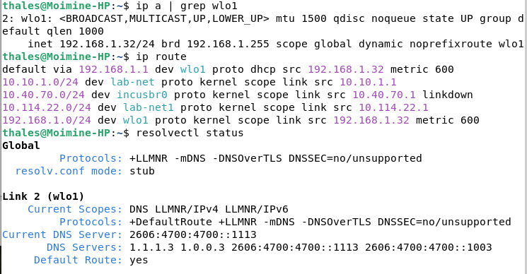

## Step 0.2 - Understanding Incus

**Goal:** get familiar with Incus's core concepts before creating any instance.

**Installation and initialization:**
```bash
apt install incus
incus admin init
```

**Concepts covered:**
- **Storage pool vs storage volume** : the pool is the total physical space available to all instances; a volume is the portion of that space dedicated to a specific instance.
- **Profile** : a reusable configuration template, applied to one or more instances to avoid repeating the same settings on every creation.
- **Project** : an isolation space, used to keep groups of instances, networks, and profiles separate within a single Incus host.
- **Network** : a managed bridge that instances connect to in order to communicate with each other and the outside world. By default, `incus admin init` creates one such bridge (`incusbr0`), used automatically unless another network is specified.
- **Built-in network stack** : Incus runs a `dnsmasq` service by default, acting as both DHCP and DNS server on every network it creates.
- **Hypervisor** : Incus VMs run on KVM, the Linux kernel's native hypervisor.

**Commands used to explore these concepts:**
```bash
incus storage list
incus project list
incus network list
incus profile list
```
Storage list :

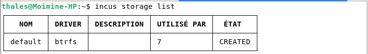

Network list :

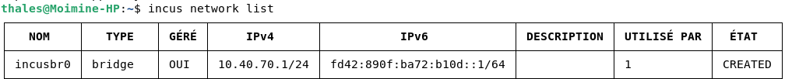

---

# Phase 1 - First virtual network

**Goal:** understand how machines communicate with each other.

## Step 1.1 - Create a network

```text
Name   : lab-net
Subnet : 10.10.1.0/24
```

## Step 1.2 - First container (`debian1`)

```bash
incus shell debian1
ip a
```

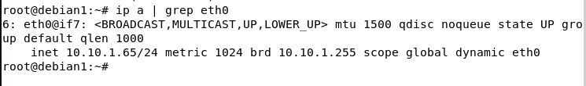

## Step 1.3 - Second container (`debian2`)

```bash
incus shell debian2
ip a
```

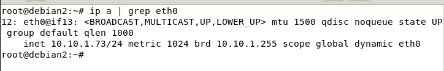

## Observations: DHCP, DNS, ARP, ICMP and NAT

### DHCP

- Exchange between the DHCP server (`dnsmasq`, built into Incus) and the machines on `lab-net`, for IP address assignment following the DORA cycle: Discover, Offer, Request, Acknowledge.
- The protocol uses two UDP ports:
  - port 67 (`bootps`): the **server** listens here (receives Discover and Request);
  - port 68 (`bootpc`): the **client** listens here (receives Offer and Acknowledge).

```bash
sudo tcpdump -i lab-net port 67 or port 68 -vvv
```

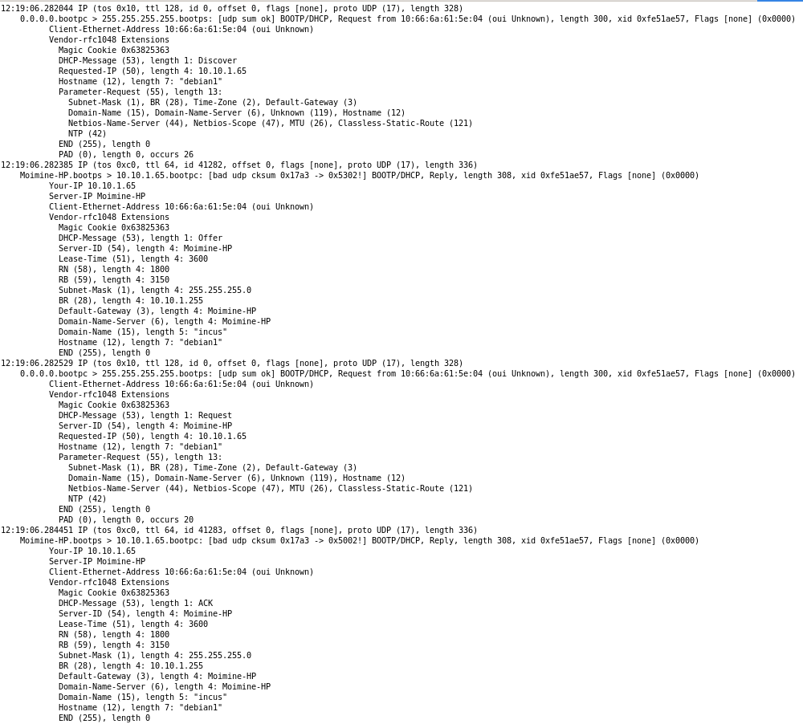

### DNS

- Name resolution, required to reach the internet.
- Distinction between the local resolver (the `systemd-resolved` stub) and authoritative/recursive DNS servers.
- The protocol uses port 53: UDP by default, TCP for larger responses and zone transfers.

```bash
nslookup google.com
host google.com
dig google.com
```

### ARP

- Capturing ARP frames (`who-has` / `is-at`) between two test containers.
- Different behavior between `arping` and `ping` regarding the kernel's neighbor cache: `arping` stays strictly at layer 2 and doesn't update the neighbor cache, while `ping` triggers a normal ARP resolution and creates a `REACHABLE` entry.

```bash
incus exec debian1 -- arping -c 2 debian2
incus exec debian1 -- ip neigh show
```

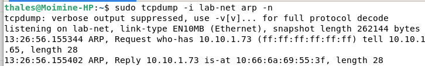

After these exchanges, each machine caches its peer's MAC address:

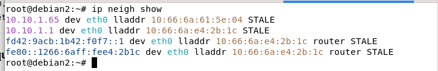

### ICMP

- ICMP Echo Request / Echo Reply sequences.
- The `Destination Host Unreachable` case, generated locally when ARP resolution fails.
- How TTL works, and how `traceroute` makes use of it.

```bash
incus exec debian1 -- ping debian2
```

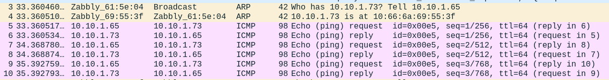

```bash
incus exec debian1 -- ip route
incus exec debian1 -- traceroute debian2
incus exec debian1 -- traceroute google.com
```

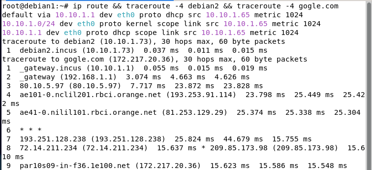

### NAT

- Address translation: containers (private IP `10.10.1.x`) reach the internet masked behind the host machine's IP (`192.168.1.32`).
- Verified by comparing two captures, before and after translation (bridge interface, then the host's outbound interface).

```bash
incus exec debian1 -- ping -c 2 8.8.8.8
```

On the host, before translation (the container's IP is visible):

```bash
sudo tcpdump -i lab-net icmp -n
```

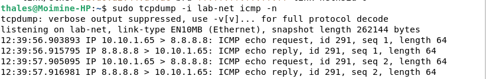

Then after translation (the host's IP is visible):

```bash
sudo tcpdump -i wlo1 icmp -n
```

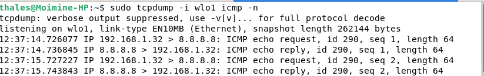

---

# Phase 2 - Network servers

**Goal:** set up DHCP and DNS so machines on the network can communicate without any manual configuration.

## Step 2.1 - Create a profile

```text
Name        : lab-limits
Description : baseline configuration shared by all containers/VMs used throughout the lab
```

This profile is shared across every instance in the lab: it's created in the `default` project and stays usable from other projects thanks to `features.profiles=false`.

```bash
incus profile create lab-limits
incus profile edit lab-limits < lab-limits.yaml
```

Config file: [`lab-limits.yaml`](configs/lab-limits.yaml)

## Step 2.2 - Create a project

```text
Name        : lab-srv
Description : groups the server machines (DHCP and DNS containers)
```

```bash
incus project create lab-srv --config features.profiles=false
incus project switch lab-srv
```

## Step 2.3 - Create a network

DHCP and DNS built into Incus are disabled on this network, so my own servers are the ones handling address assignment and name resolution.

```text
Name        : lab-net1
Description : lab network, 10.114.22.0/24, no built-in DHCP/DNS, domain homelab.local
```

```bash
incus network create lab-net1 ipv4.address=10.114.22.1/24 ipv4.nat=true ipv4.dhcp=false dns.mode=none dns.domain=homelab.local
```

**Note:** the network lives in the `default` project and is shared with `lab-srv` (`features.networks=false`). Per-project network isolation in Incus requires OVN, which isn't needed here.

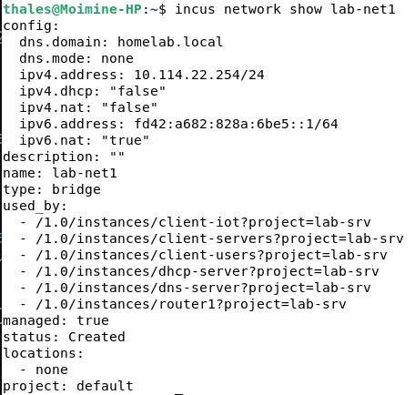

## Step 2.4 - DHCP server

```text
Machine  : dhcp-server
Software : Kea DHCP
```

```bash
incus launch images:debian/13 dhcp-server --profile default --profile lab-limits --network lab-net1
apt install kea-dhcp4-server
```

### Container network configuration

`dhcp-server` uses a static IP address (`10.114.22.2`), configured with `systemd-networkd` in `/etc/systemd/network/eth0.network`. 

Config file: [`eth0.network`](configs/eth0.network)

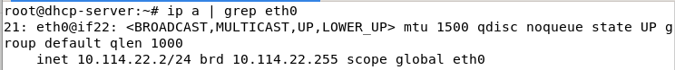 

### Kea configuration (`/etc/kea/kea-dhcp4.conf`)

**Note on future changes:** the `routers` option currently points to `10.114.22.1` (the `lab-net1` Incus bridge), used temporarily as the gateway. It will be updated to the virtual router's address once Phase 3 is done.

### Validation

```bash
kea-dhcp4 -t /etc/kea/kea-dhcp4.conf
sudo systemctl restart kea-dhcp4-server
sudo systemctl status kea-dhcp4-server
```

Full config file: [kea-dhcp4.conf](configs/kea-dhcp4.conf) 

**Tutorial used as a reference:** [Setting up a Kea DHCP server](https://www.it-connect.fr/linux-installer-et-configurer-un-serveur-dhcp-kea-sur-debian/)

---

## Step 2.5 - DNS server

```text
Machine  : dns-server
IP       : 10.114.22.3 (DHCP reservation by MAC address)
Software : bind9
Zone     : homelab.local
```

```bash
incus launch images:debian/13 dns-server --profile default --profile lab-limits --network lab-net1
apt install bind9 dnsutils
```

**DHCP result:** `dns-server` correctly receives its reserved address `10.114.22.3` from Kea, matching the configuration.

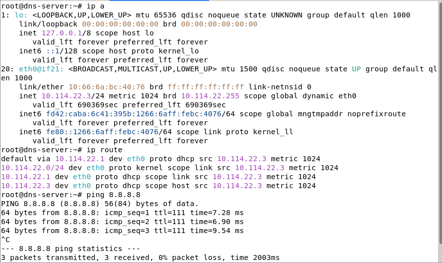

### Configuring bind9 (config files under `/etc/bind/`)

**First step:** configure bind9's general options in `/etc/bind/named.conf.options`.
Config used: [named.conf.options](configs/named.conf.options).

**Second step:** create and configure the forward and reverse DNS zones.

Zones are declared in `/etc/bind/named.conf.local`. This file tells bind9 which zones it's responsible for, and which zone files to use as the underlying database.

**Zone config file:** [named.conf.local](configs/named.conf.local).

Next, create and populate the zone files:
- Forward zone: name-to-IP records (e.g. dns-server.homelab.local → 10.114.22.3).
- Reverse zone: IP-to-name records (e.g. 10.114.22.3 → dns-server.homelab.local).

- Forward zone file: [db.homelab.local](configs/db.homelab.local).
- Reverse zone file: [db.reverse.homelab.local](configs/db.reverse.homelab.local).

**Third step:** check the syntax of both zone files, then restart the BIND9 service:

```bash
named-checkzone homelab.local /etc/bind/db.homelab.local
named-checkzone 22.114.10.in-addr.arpa /etc/bind/db.reverse.homelab.local
sudo systemctl enable --now named.service
sudo systemctl status named.service

# After a zone edit (increment the serial): reload the running server
sudo rndc reload
```

**Resolution test results with bind9:**

Resolution through the recursive resolver:

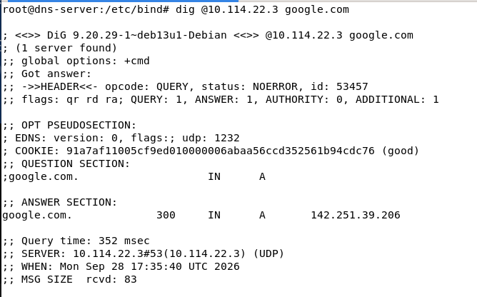

Local reverse resolution:

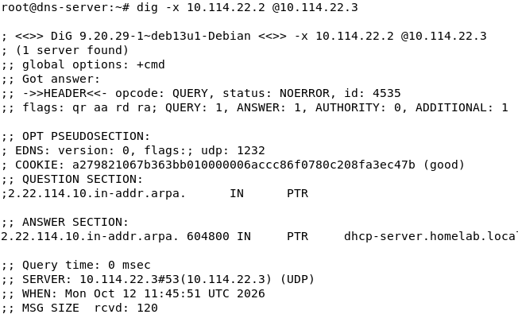

**Tutorial used as a reference:** [Setting up a DNS server with BIND9](https://www.it-connect.fr/dns-avec-bind-9/)

---

## Step 2.6 - DHCP and DNS together

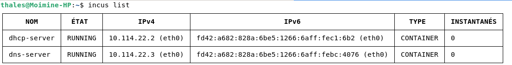

---

## Phase 3 - Routing and VLANs

**Goal:** replace the Incus bridge as my network gateway with a real router (a VM), split the lab into four VLANs, and give every VLAN internet access through NAT.

> **Note:** the Phase 2 text above was written before the VLAN split. The lab network `10.114.22.0/24` is now divided into four `/26` subnets, so the `dhcp-server` and `dns-server` network settings must use a `/26` mask from now on.

### Step 3.1 - Create the router VM

I created a Debian 13 VM that will act as the router:

```bash
incus launch images:debian/13 router1 --vm --project lab-srv --profile default --profile lab-limits
```

It needs two interfaces: one on the lab network (`lab-net1`) and one toward the outside world.

My first idea was a `macvlan` NIC on the host's Wi-Fi interface (`wlo1`). It failed: the router never received a DHCP Offer.

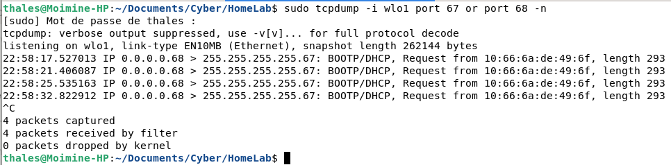

The reason is that a Wi-Fi association exposes a single MAC address, so frames from a second MAC (the macvlan) are dropped. I switched to a bridged NIC on `incusbr0`, which gives me NAT toward the host (a double NAT, but it works):

```bash
incus config device add router1 eth1 nic nictype=bridged parent=incusbr0 --project lab-srv
incus network set incusbr0 ipv4.nat=true
incus network set lab-net1 ipv4.nat=false
```

`lab-net1` no longer does NAT: the router will do it. I'll retry macvlan later over Ethernet.

### Step 3.2 - Static address for the LAN side (inside `router1`)

The router needs a fixed address on the LAN. I want it to be `10.114.22.1`, but this address is currently used by the Incus bridge. So I moved the bridge to another address, **on the host**:

```bash
incus network set lab-net1 ipv4.address=10.114.22.254/24
```

Then, **inside `router1`**, I configured `enp5s0` statically with systemd-networkd (`/etc/systemd/network/enp5s0.network`):

```ini
[Match]
Name=enp5s0

[Network]
Address=10.114.22.1/24
DHCP=false
```

Full file: [configs/router1/network/enp5s0.network](configs/enp5s0.network)

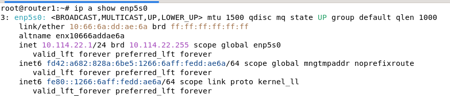

### Step 3.3 - Make the bridge VLAN-aware (on the host)

By default the Incus bridge ignores VLAN tags. I enabled VLAN filtering on it and allowed the tags on the router's port:

```bash
sudo ip link set dev lab-net1 type bridge vlan_filtering 1
incus config device set router1 eth0 vlan.tagged "10,20,30,40" --project lab-srv
```

Verification:

```bash
ip -d link show lab-net1 | grep -oE 'vlan_filtering [0-9]+|vlan_protocol [0-9.A-Za-z]+'
sudo bridge vlan show
```

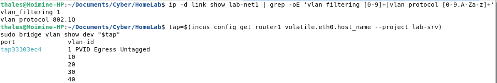

The router's port (its `tap` interface, found with `incus config get router1 volatile.eth0.host_name --project lab-srv`) now carries VLANs 10, 20, 30 and 40.

**Persistence:** the `ip link set` command is lost at reboot, so I wrapped it in a systemd service on the host, with a drop-in override:

- [configs/host/lab-net1-vlan.service](configs/lab-net1-vlan.service)
- [configs/host/lab-net1-vlan.service.d/override.conf](configs/lab-net1-vlan.service.d/override.conf)

### Step 3.4 - VLAN interfaces (inside `router1`)

Each VLAN gets its own subnet and its own sub-interface on the router:

| VLAN | Name | Router address |
|---|---|---|
| 10 | ADMIN | 10.114.22.1/26 |
| 20 | USERS | 10.114.22.65/26 |
| 30 | SERVERS | 10.114.22.129/26 |
| 40 | DMZ | 10.114.22.193/26 |

`enp5s0.network` now declares the four VLANs (`VLAN=enp5s0.10`, `VLAN=enp5s0.20`, `VLAN=enp5s0.30`, `VLAN=enp5s0.40`), and each VLAN needs a `.netdev` (the interface) and a `.network` (its address).

Example for VLAN 10:

```ini
# enp5s0.10.netdev
[NetDev]
Name=enp5s0.10
Kind=vlan

[VLAN]
Id=10
```

```ini
# enp5s0.10.network
[Match]
Name=enp5s0.10

[Network]
Address=10.114.22.1/26
```

VLANs 20, 30 and 40 follow exactly the same pattern with their own ID and address. All the files are in [configs repertory/](configs/).

The WAN interface `enp6s0` simply asks for an address (`DHCP=ipv4`). Then:

```bash
systemctl enable --now systemd-networkd
systemctl restart systemd-networkd
```

### Step 3.5 - Enable routing (inside `router1`)

A Linux machine does not forward packets between interfaces by default. I enabled it permanently in `/etc/sysctl.d/99-router.conf`:

```
net.ipv4.ip_forward=1
```

```bash
sysctl --system
```

File: [configs/router1/99-router.conf](configs/99-router.conf)

### Step 3.6 - NAT with nftables (inside `router1`)

```bash
apt install nftables
```

The ruleset accepts forwarded traffic and masquerades everything leaving through the WAN interface (`enp6s0`) from the lab range. 

File: [configs/router1/nftables.conf](configs/nftables.conf)

```bash
nft -c -f /etc/nftables.conf
systemctl enable --now nftables
```

> **Security note:** this ruleset is deliberately permissive (everything is forwarded). It's only here to prove routing works. Phase 4 will turn it into a real firewall policy.

### Step 3.7 - DHCP relay for the VLANs (inside `router1`)

DHCP Discover messages are broadcasts, so they never cross a router. My Kea server (`10.114.22.2`) is in VLAN 10 and the clients in other VLANs can't reach it directly. I installed a relay on the router that forwards DHCP requests to Kea:

```bash
apt install dhcp-helper
```

with the server set to `10.114.22.2` (running as `dhcp-helper -r /run/dhcp-helper.pid -s 10.114.22.2`).

On the Kea side, there is now one `subnet4` entry per VLAN (each with its own `id`, pool, and `routers` option pointing to the router address of that VLAN). File: [configs/kea-dhcp4.conf](configs/kea-dhcp4.conf)

### Step 3.8 - Place the machines in their VLANs (on the host)

An untagged VLAN on a NIC makes the bridge put that machine's traffic into the given VLAN:

```bash
incus config device override dhcp-server eth0 vlan=10 --project lab-srv
incus config device override dns-server eth0 vlan=10 --project lab-srv
incus config device override client-users eth0 vlan=20 --project lab-srv
incus config device override client-servers eth0 vlan=30 --project lab-srv
incus config device override client-iot eth0 vlan=40 --project lab-srv
incus restart dhcp-server dns-server client-users client-servers client-iot --project lab-srv
```

| Machine | VLAN | Subnet |
|---|---|---|
| dhcp-server, dns-server | 10 (ADMIN) | 10.114.22.0/26 |
| client-users | 20 (USERS) | 10.114.22.64/26 |
| client-servers | 30 (SERVERS) | 10.114.22.128/26 |
| client-iot | 40 (DMZ) | 10.114.22.192/26 |

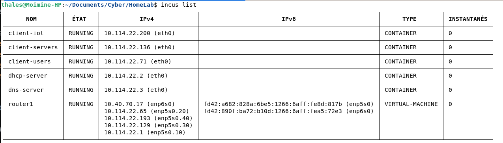

### Step 3.9 - Validation

**Router state** (inside `router1`):

```bash
ip -br addr
ip route
sysctl net.ipv4.ip_forward
nft list ruleset
```

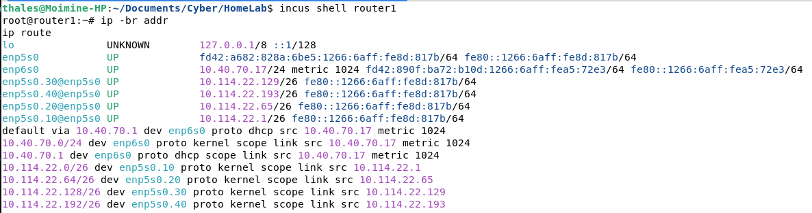

**Bridge ports** (on the host): each container's port is in its own VLAN, untagged (PVID), and the router's port carries all four tags.

```bash
sudo bridge vlan show
```


**From a client** (example with `client-users`):

```bash
incus exec client-users --project lab-srv -- ip -4 addr show eth0
incus exec client-users --project lab-srv -- ping -c 2 10.114.22.65
incus exec client-users --project lab-srv -- ping -c 2 1.1.1.1
incus exec client-users --project lab-srv -- nslookup dns-server.homelab.local
incus exec client-users --project lab-srv -- nslookup google.com
```

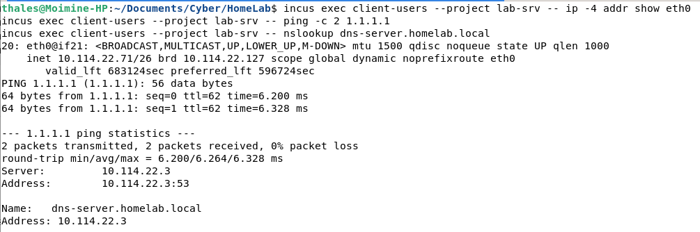

I ran the same checks on `client-servers` and `client-iot`.

**Results:**

- Each client gets an address in the `/26` of its own VLAN, through the relay.
- Each client reaches its gateway (the router's address in its VLAN).
- Each client reaches the internet (`1.1.1.1`).
- Internal names (`dns-server.homelab.local`) and external names (`google.com`) both resolve.

**Path to the internet:**

```bash
incus exec client-users --project lab-srv -- traceroute -n -w 1 -q 1 8.8.8.8
```

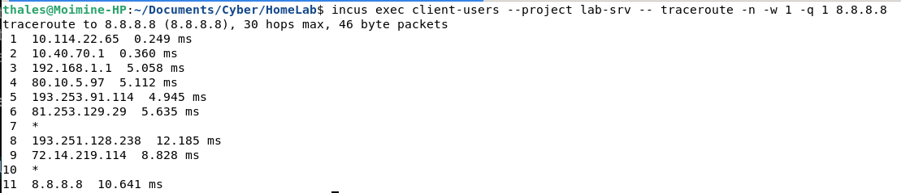

- Hop 1: `router1` (`10.114.22.65`), the client's gateway.
- Hop 2: `incusbr0` (`10.40.70.1`), the second bridge, which does the first NAT.
- Hop 3: my home box (`192.168.1.1`), the second NAT.

I use `-n` (no reverse DNS), `-w 1` (1 s timeout) and `-q 1` (one probe per hop) because the default BusyBox traceroute waits 3 seconds on every silent hop.

---

# Phase 4 - Firewall

**Goal:** control the traffic that crosses `router1`, not just route it. Until now the router forwarded everything. In this phase I turn it into a firewall that only allows the flows I decided on.

I used nftables on `router1`. The full ruleset is here: [`nftables.conf`](configs/nftable_firewall.conf)

## Step 4.1 - Write the policy before the rules

Before typing any rule, I decided what each VLAN is allowed to do. A firewall starts from a written policy, not from rules typed at random.

| From | To | Decision | Why |
|---|---|---|---|
| ADMIN | everywhere | allow | this is the administration VLAN, it needs to reach everything (the DNS server also needs the Internet for its forwarders) |
| USERS | DNS server | allow | the DNS server sits in ADMIN, so without this exception users could not resolve any name |
| USERS | rest of ADMIN | block | users have no reason to reach the infrastructure |
| USERS | SERVERS | allow | users will need the services hosted there |
| USERS | DMZ | block | |
| USERS | Internet | allow | |
| SERVERS | DNS server | allow | same reason as for users |
| SERVERS | ADMIN, USERS, DMZ | block | a server should never start a connection toward the other zones |
| SERVERS | Internet | allow | updates |
| DMZ | DNS server | allow | otherwise the DMZ could not resolve names |
| DMZ | ADMIN, USERS, SERVERS | block | the DMZ is the least trusted zone |
| DMZ | Internet | allow | |

Everything that is not explicitly allowed is blocked. Answers to allowed connections come back through the state tracking described below, so I never need a rule for the return path.

## Step 4.2 - Structure of the ruleset

The file has two tables and four chains.

| Table | Chain | Default policy | Why |
|---|---|---|---|
| `inet filter` | `input` | drop | protects the router itself: only a few flows are useful to it |
| `inet filter` | `forward` | drop | this is the real firewall, it filters what crosses the router between VLANs and toward the Internet |
| `inet filter` | `output` | accept | the router sends its own legitimate traffic (DHCP relay, WAN lease, updates) and I have no reason to restrict it |
| `ip nat` | `postrouting` | accept | NAT has to happen after the routing decision, when the outgoing interface is known |

I used the `inet` family for filtering because the router also handles IPv6, so one table covers both versions. The NAT table is `ip` because I only translate IPv4 private addresses.

At the top of the file I use `define` variables (interfaces, the DNS and DHCP servers, port numbers) so the rules stay readable and a change is made in one place.

## Step 4.3 - Rules that are easy to forget

Most of the work is in `forward`, but a few rules in `input` are needed or the lab silently breaks:

- **DHCP (UDP 67) from the VLAN interfaces.** The DHCP relay on `router1` listens there. Without this rule, no client gets an address. It also covers the answers coming back from Kea.
- **DHCP (UDP 68) on the WAN interface.** The router renews its own lease from `incusbr0`.
- **ICMPv6 neighbor discovery.** IPv6 does not use ARP. It uses ICMPv6 messages instead, so blocking them breaks IPv6 on the router. ARP itself is never filtered by this table.
- **Ping toward the router.** Useful to test each VLAN gateway.
- **Established and related connections first.** Replies to allowed traffic are accepted before any other rule.

The order of the rules matters, because the first match wins. In `forward`, the DNS exception for USERS and SERVERS comes **before** the block toward ADMIN. The DNS server lives in ADMIN, so the opposite order would cut name resolution for everybody.

## Step 4.4 - Drop or reject

Both verdicts block a packet, but the sender does not see the same thing:

- `drop` discards the packet silently. The sender just waits until it times out. A scanner like `nmap` sees the port as filtered.
- `reject` discards the packet and sends an error back (an ICMP message). The sender knows immediately that it is refused. A scanner sees the port as closed.

I use `reject` for the blocks between my internal VLANs (USERS or SERVERS toward ADMIN, SERVERS toward USERS): a fast and clear answer is more useful when I debug my own lab. I use `drop` for everything involving the DMZ, because that zone is the least trusted and I do not want to give it any information about what exists behind the firewall.

## Step 4.5 - Proving that a rule is really hit

A ping that fails only shows that something blocked it, not which rule. To prove it, I added a `counter` to one rule, USERS to ADMIN, as an example:

```
iifname $USERS oifname $ADMIN counter reject
```

Then I read the counter before and after two pings from `client-users` to the DHCP server, all from the host with `incus exec`:

```bash
incus exec router1 --project lab-srv -- nft list chain inet filter forward | grep counter
incus exec client-users --project lab-srv -- ping -c 2 10.114.22.2
incus exec router1 --project lab-srv -- nft list chain inet filter forward | grep counter
```

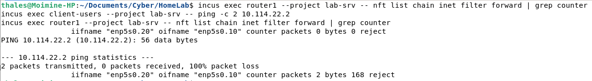

The counter goes from 0 to 2 packets (168 bytes, two ICMP packets of 84 bytes), so this exact rule stopped them.

## Step 4.6 - Check, load and persist the ruleset

In `router1`:

```bash
nft -c -f /etc/nftables.conf      # check the syntax only, nothing is applied
nft -f /etc/nftables.conf         # load the file
nft list ruleset                  # show what is really loaded, with the counters
systemctl enable --now nftables   # load it now and at every boot
systemctl status nftables --no-pager
```

Some notes about this:

- `nft -c` prints nothing when the file is valid. I always run it before loading, because a mistake in a firewall file is easy to make.
- The file starts with `flush ruleset`, so loading it replaces the previous ruleset entirely. This also resets the counters to zero.
- `nft -f` only changes the rules in memory. Without `systemctl enable --now nftables`, the rules disappear at the next reboot. The service reads `/etc/nftables.conf` at startup.

## Step 4.7 - Validation

The blocked side is already proven by the counter in Step 4.5. To check the allowed side, I ran two commands from `client-users`, again from the host with `incus exec`:
 
```bash
incus exec client-users --project lab-srv -- ping -c 2 10.114.22.136
incus exec client-users --project lab-srv -- nslookup google.com
```
 
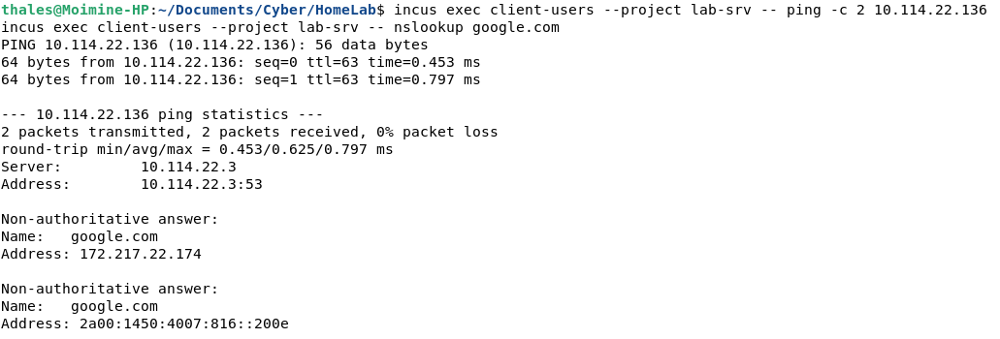
 
- The ping to `client-servers` (VLAN 30) works. Its TTL is 63, one less than the default 64, which shows the packet went through `router1`.
- The DNS lookup works even though USERS cannot reach the rest of ADMIN. This confirms that the DNS exception placed before the block is doing its job.

## Current limits

- The `ADMIN` VLAN can reach everything, and `USERS` can reach all of `SERVERS`. When real services exist, I will restrict these to the ports they need.
- Rules in `forward` only cover IPv4. IPv6 between VLANs and toward the Internet is blocked by the default policy.
- I do not log blocked traffic yet. This will come with the monitoring phase.

## Next

I plan to rebuild the same policy on pfSense and compare it with this nftables version. I will also re-check these rules when I place all the machines in their final segments in Phase 8.

---

# Phase 5 - Active Directory

**Goal:** understand the most common enterprise network environment.

## Step 5.1 - Domain controller

I started with the Windows Server evaluation ISO (free for 180 days, no account needed) from [microsoft.com/fr-fr/evalcenter/download-windows-server-2022](https://www.microsoft.com/fr-fr/evalcenter/download-windows-server-2022).

Incus VMs use `virtio` devices for disk and network. Windows does not include `virtio` drivers by default, so the installer cannot see the virtual disk unless the drivers are supplied to it. I repacked the Windows ISO with `distrobuilder`, which injects the drivers directly into the installer image instead of loading them by hand during setup:

```bash
sudo apt install -y distrobuilder rsync wimtools genisoimage libwin-hivex-perl virt-viewer
sudo distrobuilder --cache-dir ~/distrobuilder-cache repack-windows --windows-arch=amd64 SERVER_EVAL_x64FRE_fr-fr.iso SERVER_EVAL_x64FRE_fr-fr.incus.iso
```

`distrobuilder` downloads the virtio drivers itself when `--drivers` is not given.

I redirected distrobuilder's working directory to `/home` with `--cache-dir` (the root filesystem is small).

Then I created the VM: empty (no base image, since it boots from the ISO), on the `bigpool` storage pool, connected to the `lab-net1` switch in VLAN 10 (ADMIN), with the Windows ISO and a vTPM attached:

```bash
incus init ws-dc1 --empty --vm --project lab-srv -s bigpool
incus config device set ws-dc1 root size=60GiB --project lab-srv
incus config device override ws-dc1 eth0 vlan=10 --project lab-srv
incus config device set ws-dc1 eth0 network=lab-net1 --project lab-srv
incus config set ws-dc1 limits.cpu 4 --project lab-srv
incus config set ws-dc1 limits.memory 6GiB --project lab-srv
incus config device add ws-dc1 vtpm tpm --project lab-srv
incus config device add ws-dc1 install disk source=/home/thales/Téléchargements/SERVER_EVAL_x64FRE_fr-fr.incus.iso boot.priority=10 --project lab-srv
incus start ws-dc1 --console=vga --project lab-srv
```

A few notes from getting this right:

- `incus console --type=vga` needs a SPICE client on the host (`virt-viewer`) to actually show a window; without it, it only prints a socket path.
- a vTPM is a software-emulated TPM chip: it gives the VM a virtual version of the physical security chip that normally stores encryption keys and checks boot integrity (used by BitLocker, Windows Hello, and required by Windows 11). Windows Server does not require it, but I added one anyway in case AD DS or disk encryption needs it later.

### Installing Windows Server and promoting it to domain controller

From `sconfig`, I renamed the computer and set it to keep its current DHCP-leased address as a permanent reservation in Kea rather than a static IP (option 8, then the matching entry in [`kea-dhcp4.conf`](configs/kea-dhcp4.conf)) - `10.114.22.6`. I checked the result from PowerShell:

```powershell
ipconfig /all
```

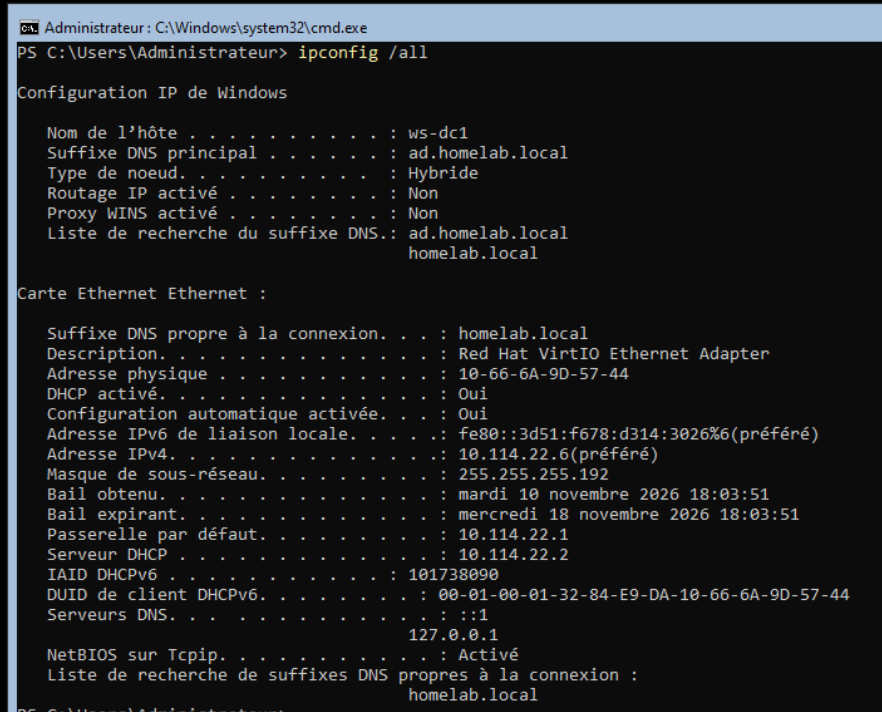

Then I promoted it to the first domain controller of a brand new forest:

```powershell
Install-ADDSForest -DomainName "ad.homelab.local" -DomainNetbiosName "AD" -InstallDns
```

I picked `ad.homelab.local` (a subdomain of the existing `homelab.local` zone already served by `dns-server`) over `homelab.local` itself or a fully separate `lab.local`, specifically so the two DNS zones would have to cooperate through delegation (Step 5.2) instead of just coexisting - closer to a real split between an existing network's DNS and a newly deployed AD environment. The command also asks for a DSRM password (Directory Services Restore Mode - a separate emergency password used only to restore the directory in maintenance mode); like every other admin password in this lab, it stays in my own notes.

`-InstallDns` installs the AD-integrated DNS role at the same time: the DNS zone for `ad.homelab.local` is no longer a flat text file like BIND's, it lives inside the AD database itself and replicates automatically to every domain controller.

Once it rebooted into the domain, a couple of filtered checks confirm the forest is up:

```powershell
Get-ADDomain | Select-Object DNSRoot, NetBIOSName, DomainMode, PDCEmulator
Get-ADForest | Select-Object Name, ForestMode, GlobalCatalogs
```

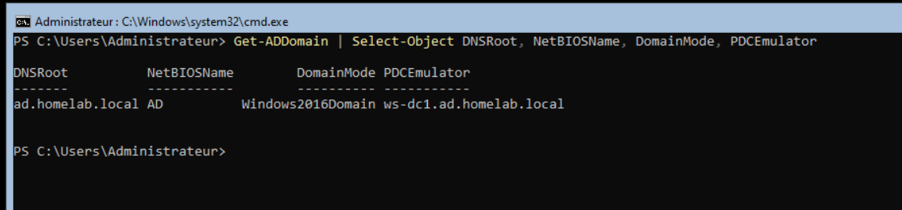

## Step 5.2 - DNS delegation between `homelab.local` and `ad.homelab.local`

With two separate DNS zones now in play - `homelab.local` (BIND, on `dns-server`) and `ad.homelab.local` (AD-integrated, on `ws-dc1`) - machines outside the AD zone need a way to find it, and `ws-dc1` needs a way to resolve everything else.

**On `ws-dc1`:** I added `dns-server` as a forwarder, so any name outside its own zone gets sent there instead of failing or going straight to the internet:

```powershell
Add-DnsServerForwarder -IPAddress 10.114.22.3
Resolve-DnsName dns-server.homelab.local   # resolved through the forwarder
Resolve-DnsName google.com                 # forwarded further still, by dns-server's own forwarders
```

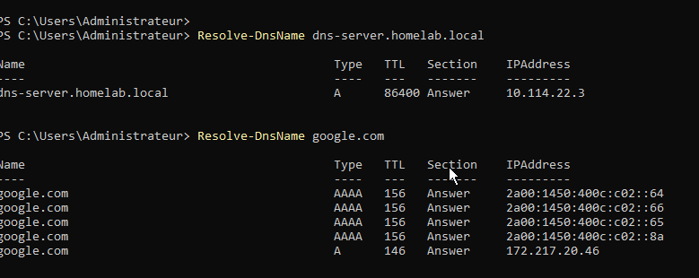

**On `dns-server`:** the parent zone needs to know where to send anything under `ad.homelab.local`. I first tried a classic DNS delegation - an `NS` record plus a glue `A` record, added directly inside the existing `db.homelab.local` zone file (no new zone block needed in `named.conf.local`, since the delegated name is just data inside the parent zone):

```
ad.homelab.local.     IN  NS   ws-dc1.homelab.local.
ws-dc1.homelab.local. IN  A    10.114.22.6
```

```bash
named-checkzone homelab.local /etc/bind/db.homelab.local
sudo rndc reload
```

This loaded fine and `dig +norecurse @10.114.22.3 ad.homelab.local NS` correctly showed the referral - the delegation itself was valid. But any *recursive* query for `ad.homelab.local` (the kind every real client sends) still came back `NXDOMAIN`. The reason: `dns-server` already had global forwarders configured for general internet resolution:

```
forwarders {
    1.1.1.3;
    1.0.0.3;
};
```

Without an explicit `forward only` directive, BIND's default behaviour sends anything outside its own non-delegated authoritative data to those forwarders first - including, surprisingly, names under a delegation it already knows about locally. So queries for `ad.homelab.local` were quietly leaving for Cloudflare instead of going to `ws-dc1`, and Cloudflare correctly answered `NXDOMAIN` since the name does not exist publicly.

The fix is a dedicated `forward` zone for that one subdomain, which takes priority over the global forwarders. Added in `/etc/bind/named.conf.local` on `dns-server`:

```
zone "ad.homelab.local" {
    type forward;
    forward only;
    forwarders { 10.114.22.6; };
};
```

```bash
named-checkconf
rndc reconfig
dig @10.114.22.3 ad.homelab.local A +noall +answer
dig @10.114.22.3 _ldap._tcp.ad.homelab.local SRV +noall +answer
```

`forward only` (as opposed to the default `forward first`) stops BIND from ever falling back to its own recursion or the global forwarders for this specific zone. The second `dig`, for an `SRV` record rather than a plain `A`, matters because that is what AD clients actually query first when locating a domain controller (`_ldap._tcp.<domain>`, `_kerberos._tcp.<domain>`) - testing only a plain name lookup can look fine while the records that matter for a real join are still broken.

Config file: [`named.conf.local`](configs/named.conf.local).

## Step 5.3 - AD structure: departments, groups and the AGDLP model

Before creating any client machine, I designed an OU/group layout representative enough to be useful later, in Phase 7, as a target for a red-team exercise - not just three empty folders.

**Three departments:** IT, Finance, RH (kept to three on purpose - enough to be meaningful without turning this into a full enterprise directory for a home lab).

```powershell
New-ADOrganizationalUnit -Name "IT" -Path "DC=ad,DC=homelab,DC=local"
New-ADOrganizationalUnit -Name "Finance" -Path "DC=ad,DC=homelab,DC=local"
New-ADOrganizationalUnit -Name "RH" -Path "DC=ad,DC=homelab,DC=local"
```

Each OU holds its own department's user accounts and (once joined) computer objects.

**Groups follow the AGDLP model** (Account -> Global Group -> Domain Local Group -> Permission), the standard Microsoft pattern for assigning access without ever putting a user directly on a permission list.

Global groups, one per department, live inside their own OU:

```powershell
New-ADGroup -Name "GG-IT"      -GroupScope Global -GroupCategory Security -Path "OU=IT,DC=ad,DC=homelab,DC=local"
New-ADGroup -Name "GG-Finance" -GroupScope Global -GroupCategory Security -Path "OU=Finance,DC=ad,DC=homelab,DC=local"
New-ADGroup -Name "GG-RH"      -GroupScope Global -GroupCategory Security -Path "OU=RH,DC=ad,DC=homelab,DC=local"
```

Domain local groups, one per resource, live together in their own dedicated OU rather than scattered across the department OUs:

```powershell
New-ADOrganizationalUnit -Name "Groupes-Ressources" -Path "DC=ad,DC=homelab,DC=local"

New-ADGroup -Name "DL-RH-Confidential-Read"    -GroupScope DomainLocal -GroupCategory Security -Path "OU=Groupes-Ressources,DC=ad,DC=homelab,DC=local"
New-ADGroup -Name "DL-Finance-Share-ReadWrite" -GroupScope DomainLocal -GroupCategory Security -Path "OU=Groupes-Ressources,DC=ad,DC=homelab,DC=local"
New-ADGroup -Name "DL-IT-LocalAdmins"          -GroupScope DomainLocal -GroupCategory Security -Path "OU=Groupes-Ressources,DC=ad,DC=homelab,DC=local"
```

Then the nesting itself - global group inside domain local group:

```powershell
Add-ADGroupMember -Identity "DL-RH-Confidential-Read"    -Members "GG-RH"
Add-ADGroupMember -Identity "DL-Finance-Share-ReadWrite" -Members "GG-Finance"
Add-ADGroupMember -Identity "DL-IT-LocalAdmins"          -Members "GG-IT"
```

The global group (`GG-*`) represents *who someone is* (their department); the domain local group (`DL-*`) represents *what a resource grants access to*. Only the domain local group ever gets a real permission. This two-level indirection means a resource's ACL never has to be touched again when someone joins or leaves a department, only the global group's membership changes.

One deliberate choice here: `GG-IT` is nested into `DL-IT-LocalAdmins` (it grants IT local-administrator rights on other departments' workstations, through the GPO in Step 5.5) but into neither `DL-RH-Confidential-Read` nor `DL-Finance-Share-ReadWrite`. IT can administer those machines without being able to read what is on them, a distinction that matters a lot once Phase 7 tries to escalate from one to the other.

**One representative user per department**, each nested into its department's global group:

```powershell
$pwd = ConvertTo-SecureString "<password>" -AsPlainText -Force

New-ADUser -Name "Alice IT"    -SamAccountName "ait"  -UserPrincipalName "ait@ad.homelab.local"  -Path "OU=IT,DC=ad,DC=homelab,DC=local"      -AccountPassword $pwd -Enabled $true -ChangePasswordAtLogon $true
New-ADUser -Name "Bob Finance" -SamAccountName "bfin" -UserPrincipalName "bfin@ad.homelab.local" -Path "OU=Finance,DC=ad,DC=homelab,DC=local" -AccountPassword $pwd -Enabled $true -ChangePasswordAtLogon $true
New-ADUser -Name "Carla RH"    -SamAccountName "crh"  -UserPrincipalName "crh@ad.homelab.local"  -Path "OU=RH,DC=ad,DC=homelab,DC=local"      -AccountPassword $pwd -Enabled $true -ChangePasswordAtLogon $true

Add-ADGroupMember -Identity "GG-IT"      -Members "ait"
Add-ADGroupMember -Identity "GG-Finance" -Members "bfin"
Add-ADGroupMember -Identity "GG-RH"      -Members "crh"
```

`-ChangePasswordAtLogon $true` forces each user to set their own password on first login rather than keeping the one I typed here - the actual value used lives only in my own notes.

```powershell
Get-ADOrganizationalUnit -Filter * | Select-Object Name, DistinguishedName
Get-ADGroup -Filter * | Select-Object Name, GroupScope, GroupCategory
```

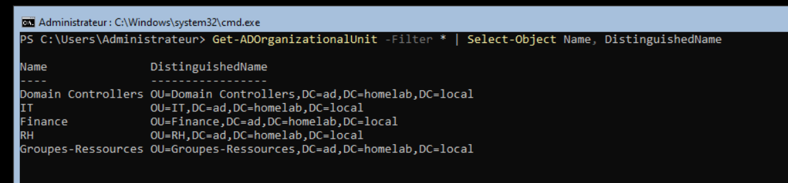
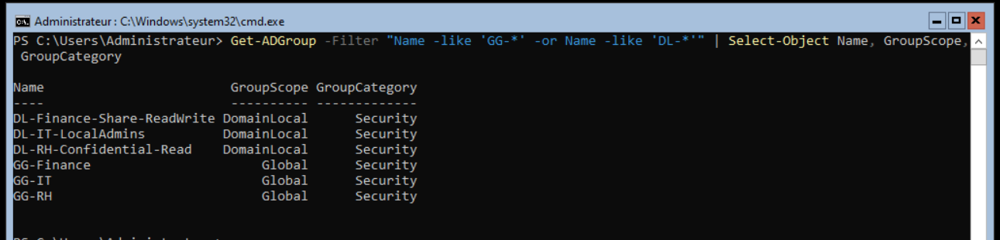

### The "sensitive data" idea

To give Phase 7 (Red Team) something concrete to go after, I planted one genuinely protected resource now: a share called `RH-Confidential$`, holding a placeholder file (`salaires_2026.txt`, with a short note making clear it is demo data, not a real payroll). It follows AGDLP end to end. For lab simplicity it is hosted directly on `ws-dc1` - in a real environment a file share should never live on a domain controller, and I list this as a known limitation below.

```powershell
New-Item -Path "C:\Shares\RH-Confidential" -ItemType Directory
Set-Content -Path "C:\Shares\RH-Confidential\salaires_2026.txt" -Value "Donnée sensible de démonstration - salaires RH confidentiels"

New-SmbShare -Name "RH-Confidential$" -Path "C:\Shares\RH-Confidential" -FullAccess "AD\DL-RH-Confidential-Read"

# Retire l'héritage NTFS par défaut et pose une ACL propre
icacls "C:\Shares\RH-Confidential" /inheritance:r
icacls "C:\Shares\RH-Confidential" /grant "AD\DL-RH-Confidential-Read:(OI)(CI)R"
icacls "C:\Shares\RH-Confidential" /grant "AD\Domain Admins:(OI)(CI)F"
```

```powershell
Get-SmbShareAccess -Name "RH-Confidential$"
icacls "C:\Shares\RH-Confidential"
Get-ADGroupMember -Identity "DL-RH-Confidential-Read"
```

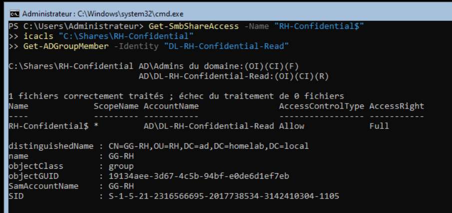

The trailing `$` in the share name hides it from normal network browsing - a realistic detail, but not a real security control, since it does nothing against an attacker who already knows the share's name.

The effective access is always the more restrictive of the two layers: the share grants Full Control to the domain local group, but NTFS only grants it Read - so the real-world result is Read-only. This gap between IT's broad admin rights and its lack of access to this one share is exactly what I plan to test later: whether a weakened permission, a Kerberoastable account, or a known CVE can be used to cross that boundary, and I may deliberately loosen a setting at that point specifically to show why it mattered.

## Step 5.4 - Client machines

### Windows clients (Finance, RH): one golden image, cloned twice

Rather than installing Windows 10 multiple times, I built one template VM, prepared it with Sysprep, and cloned it.

The ISO this time comes from a different source than the Windows Server one: [microsoft.com/fr-fr/software-download/windows10iso](https://www.microsoft.com/fr-fr/software-download/windows10iso), Microsoft's own Windows 10 media creation page.

Repacking the ISO follows the same `distrobuilder` process as the server ISO:

```bash
sudo distrobuilder --cache-dir ~/distrobuilder-cache repack-windows --windows-arch=amd64 Win10_22H2_French_x64v1.iso Win10_22H2_French_x64v1.incus.iso
```

The template VM:

```bash
incus init win10-template --empty --vm --project lab-srv -s bigpool
incus config device set win10-template root size=25GiB --project lab-srv
incus config device override win10-template eth0 vlan=20 --project lab-srv
incus config device set win10-template eth0 network=lab-net1 --project lab-srv
incus config set win10-template limits.cpu 2 --project lab-srv
incus config set win10-template limits.memory 4GiB --project lab-srv
incus config device add win10-template install disk source=/home/thales/Téléchargements/Win10_22H2_French_x64v1.incus.iso boot.priority=10 --project lab-srv
incus start win10-template --console=vga --project lab-srv
```

25GiB and 2 vCPU / 4GiB RAM, placed in VLAN 20 (USERS) straight away.

**Bypassing the Microsoft account requirement:** the OOBE (Out-Of-Box Experience, Windows's first-boot setup wizard) screen normally forces signing in with a Microsoft account before it will create a local one. At the "Configurer pour une organisation" screen, `Shift+F10` opens a command prompt, from which:

```cmd
start ms-cxh:localonly
```

jumps straight to the local "Create a user for this PC" screen (`OOBE\BYPASSNRO` is the usual fallback if that specific command ever stops working on a later Windows 10 build). I created a throwaway local account, just long enough to run Sysprep and never meant to survive past that point.

**Generalizing the image:** once on the desktop, I ran Sysprep before ever joining this template to the domain:

```cmd
sysprep.exe /generalize /oobe /shutdown
```

`/generalize` strips machine-specific identifiers - most importantly the local Security Identifier (SID) - so that cloning the VM afterwards does not produce two machines secretly sharing the same SID (which causes AD, licensing, and networking problems down the line). `/oobe` sends each clone back to a fresh out-of-box setup screen on first boot, and `/shutdown` powers the VM off cleanly once done, ready to be copied.

**Cloning and joining:**

```bash
incus copy win10-template client-finance --project lab-srv
incus copy win10-template client-rh --project lab-srv
incus start client-finance --console=vga --project lab-srv
```

Each clone goes through its own fresh OOBE (same local-account bypass as above), then gets renamed and joined to the domain in one step:

```powershell
Add-Computer -DomainName "ad.homelab.local" -NewName "client-finance" -Credential (Get-Credential) -Restart
```

The credential prompt needs the down-level logon name format, `AD\Administrateur`, not just `Administrateur`. At this point the machine has no idea yet which domain it belongs to, because it is not yet a member of one: it is still in the local Windows workgroup, a default grouping every standalone Windows machine starts in before joining a domain. Without a domain prefix, Windows assumes any username typed in refers to an account on the machine itself, so it looks for a local account called `Administrateur` rather than the one in AD - and rejects even a perfectly correct domain password, because it is checking the wrong account entirely. Prefixing it with `AD\` tells Windows explicitly to look that name up in the `AD` domain instead.

One thing I ran into and would do differently next time: **renaming a machine that is already domain-joined** (as opposed to naming it at join time) needs full RPC (port 135 plus the dynamic port range 49152 to 65535) between the client and the DC, which would have meant opening a new, much wider flow in nftables just for that one operation. Joining with a new name in one single step only needs SMB (port 445), an exception that was already open and much narrower. Setting the final hostname before or during the join, rather than after, avoids ever needing that wide RPC range and the firewall change it would require.

The firewall itself needed a new, narrow exception: client machines live in VLAN 20 (USERS) and the domain controller in VLAN 10 (ADMIN), so by the Phase 4 policy that traffic is blocked by default. I added Kerberos, LDAP, kpasswd, SMB and NTP specifically toward `ws-dc1`, in `/etc/nftables.conf` on `router1`:

```
define AD_DC = 10.114.22.6
define AD_TCP_PORTS = {88,389,445,464}
define AD_UDP_PORTS = {88,123,389,464}

iifname $USERS ip daddr $AD_DC tcp dport $AD_TCP_PORTS counter accept
iifname $USERS ip daddr $AD_DC udp dport $AD_UDP_PORTS counter accept
```

placed before the general `USERS -> ADMIN: reject` rule, same pattern as the Wazuh exception in Phase 6. Config file: [`nftables.conf`](configs/nftables.conf).

Once joined, each computer object lands by default in the generic `CN=Computers` container - not a real OU, and notably one that cannot receive GPOs - so I moved each one into its department's OU:

```powershell
Move-ADObject -Identity "CN=client-finance,CN=Computers,DC=ad,DC=homelab,DC=local" -TargetPath "OU=Finance,DC=ad,DC=homelab,DC=local"
Move-ADObject -Identity "CN=client-rh,CN=Computers,DC=ad,DC=homelab,DC=local" -TargetPath "OU=RH,DC=ad,DC=homelab,DC=local"
```

### IT department: a Linux client instead of Windows

For IT, I deliberately chose a Linux container joined via `realmd`/`sssd` rather than a third Windows clone. It is less realistic in one specific way (no GPO support at all for this client), but it makes the department line-up more representative of an actual mixed environment, and costs a lot less in CPU/RAM/disk than another full Windows VM - a trade-off I was comfortable accepting for a lab.

```bash
incus launch images:ubuntu/22.04 client-it --project lab-srv --profile default --profile lab-limits --network lab-net1
incus config device set client-it eth0 vlan=20 --project lab-srv   # 'override' fails here: --network already created an instance-level eth0
incus restart client-it --project lab-srv
```

```bash
apt install realmd sssd sssd-tools libnss-sss libpam-sss adcli samba-common-bin oddjob oddjob-mkhomedir packagekit
```

`realmd` itself does nothing directly - it detects the kind of domain available (`realm discover`, which checks the DNS `SRV` records from Step 5.2 and does a quick, unauthenticated LDAP lookup) and then hands off to the right tool: `adcli` to do the actual join, `sssd` to handle day-to-day authentication afterwards.

```bash
realm discover ad.homelab.local
realm join -v -U Administrateur ad.homelab.local
```

The first real attempt at this failed outright with `realm: No such realm found` - a direct consequence of the DNS forwarding bug described in Step 5.2, since `realm discover` depends entirely on resolving those `SRV` records correctly. Once that was fixed, discovery succeeded; the join itself then failed a second time with `Can't contact LDAP server`, this time because of the firewall rule described above (client containers sit in VLAN 20, the DC in VLAN 10) - adding the narrow AD exception resolved it.

`adcli`'s verbose output shows the real mechanics: it authenticates with Kerberos (GSSAPI/SPNEGO) using the admin credential, computes the machine account name (`client-it` -> `CLIENT-IT$`), creates that computer object in AD over LDAP, and retrieves a keytab (`/etc/krb5.keytab`) - a file holding the machine's own Kerberos secret, letting it prove its identity afterwards without ever storing a password for itself.

From here on, `sssd` is what makes day-to-day login work, through two completely separate integrations with Linux:

- **NSS** (Name Service Switch): `getent passwd`, `id`, and similar commands transparently query AD over LDAP for identity lookups, because `sssd` is registered as an NSS source.
- **PAM**: the actual password check during `login`/`su`/`sshd` goes through `pam_sss.so`, which performs real Kerberos authentication against the DC.

Two small fixes were needed before a login actually worked end to end:

```bash
pam-auth-update --enable mkhomedir
```

creates each user's `/home` directory automatically on first successful login (nothing exists ahead of time for a remote account, unlike a local one).

Under `[domain/ad.homelab.local]` in `/etc/sssd/sssd.conf`:
```ini
ad_gpo_access_control = permissive
```

`sssd`'s AD provider evaluates Group Policy for access control by default (`enforcing`), reading the SYSVOL share over SMB to decide who is allowed to log on - mirroring Windows behaviour. Since this client has no GPO written for it at all, that evaluation always failed and blocked every login with a generic `System error`. `permissive` keeps the evaluation (and its logging) without ever using it to deny access - the right compromise until a GPO actually targets Linux clients, which, realistically, will not happen here.

Config file: [`sssd.conf`](configs/sssd.conf).

```bash
realm list
id tintin@ad.homelab.local
getent passwd tintin@ad.homelab.local
su - tintin@ad.homelab.local
```

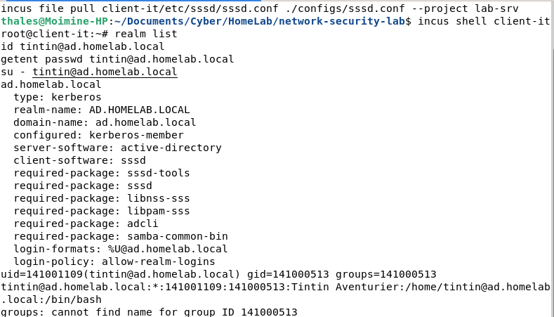

Login names are fully qualified (`user@ad.homelab.local`) by default once joined to an AD domain, specifically to avoid any collision between a local Linux account and an AD account sharing the same short name - this can be turned off (`use_fully_qualified_names = False`) once that risk is ruled out.

### Storage housekeeping along the way

The `default` Incus storage pool - a 6GiB loopback file shared by every container and small VM in the lab, `router1` and `dns-server` included - filled up completely while installing packages inside `client-it`. I grew it the same way I had already grown `bigpool` back in Phase 6, applied directly to Incus's own backing file:

```bash
sudo truncate -s 20G /var/lib/incus/disks/default.img
sudo losetup -c /dev/loop4                      # found with: sudo losetup -j /var/lib/incus/disks/default.img
sudo btrfs filesystem resize max /var/lib/incus/storage-pools/default
```

## Step 5.5 - GPO: IT gets local admin on Finance and RH workstations

This is the piece that makes `DL-IT-LocalAdmins` actually do something: a GPO that drops that group into the local Administrators group of every Finance and RH workstation, representing an IT-support model where IT can administer any department's machine without having rights to the data on it.

```powershell
New-GPO -Name "GPO-IT-LocalAdmins"
New-GPLink -Name "GPO-IT-LocalAdmins" -Target "OU=Finance,DC=ad,DC=homelab,DC=local"
New-GPLink -Name "GPO-IT-LocalAdmins" -Target "OU=RH,DC=ad,DC=homelab,DC=local"
```

The GPO object and its links to the Finance and RH OUs are created this way, but the actual setting - a Restricted Groups rule adding `DL-IT-LocalAdmins` to the local Administrators group - has to be configured through the GPO editor itself (`gpmc.msc` -> Computer Configuration -> Policies -> Windows Settings -> Security Settings -> Restricted Groups), since this isn't natively scriptable in PowerShell. I'll walk through that GUI step and document it with a screenshot next session.

Note this GPO targets Finance and RH, not IT: it's IT's group being pushed onto other departments' machines, not onto its own.

## Current limits (Active Directory)

- Only one domain controller: no redundancy, and the AD-integrated DNS has a single point of failure.
- The GPO object and its links exist, but the Restricted Groups setting itself still needs to be configured through `gpmc.msc` (Step 5.5); the IT Linux client cannot receive GPOs by design regardless.
- The firewall exception for AD traffic is per-destination-IP (`$AD_DC`), not per-service-name - adding a second DC later means updating this rule by hand.
- `RH-Confidential` is hosted directly on `ws-dc1` for lab simplicity; a file share should never live on a domain controller in production.

---

# Phase 6 - Cyber Blue Team (detection)

**Goal:** be able to detect attacks before launching them myself.

## Step 6.1 - Wazuh

**Goal:** add a monitoring layer to the lab. I installed a Wazuh server, connected one agent to it, then triggered real events to check that they show up as alerts. Wazuh plays the role of a SIEM here: it collects logs and file events from the machines and turns them into alerts.

Only the server and one agent are done in this sub-phase.

### Step 6.1.1 - Architecture

| Machine | Type | VLAN | Address | Role |
|---|---|---|---|---|
| `wazuh-server` | VM (Ubuntu 22.04) | 10 (ADMIN) | `10.114.22.10` (DHCP reservation) | manager, indexer and dashboard (all-in-one) |
| `linux-agent` | container (Ubuntu 22.04) | 20 (USERS) | `10.114.22.72` (DHCP address) | monitored machine |

The server is in ADMIN because it is part of the infrastructure. The agent is in USERS on purpose: its traffic has to cross `router1`, so the firewall from Phase 4 is really involved.

The agent talks to the server on two ports:

- `1515/tcp`: enrollment, once, when the agent registers itself.
- `1514/tcp`: events, permanently.

### Step 6.1.2 - Create the VM and the agent container

I created both machines with `incus init`, then put each one in its VLAN with `vlan=<id>` on its NIC (same method as in Step 3.8), and finally started it with `incus start`.

The server needs more disk and more resources than the rest of the lab (it runs the manager, the indexer and the dashboard together), so it does not use the shared `default` storage pool or a shared limits profile.

`/home` is on its own partition, much bigger than the root filesystem, so instead of eating into `/`, I reserved the space there: a file acting as a loop device, formatted in `btrfs`, mounted at `/mnt/incus-btrfs`, with a dedicated subvolume for Incus to use as a storage pool:

```bash
sudo truncate -s 80G /home/incus-btrfs.img
sudo mkfs.btrfs /home/incus-btrfs.img
sudo mkdir -p /mnt/incus-btrfs
sudo mount -o loop /home/incus-btrfs.img /mnt/incus-btrfs
sudo btrfs subvolume create /mnt/incus-btrfs/pool
incus storage create bigpool btrfs source=/mnt/incus-btrfs/pool
```

At first the file was mounted with a plain `mount -o loop` command, not through `/etc/fstab`, so it would not have survived a host reboot. I fixed this by adding it to `fstab`:

```bash
echo "/home/incus-btrfs.img /mnt/incus-btrfs btrfs loop,defaults,nofail 0 0" | sudo tee -a /etc/fstab
sudo umount /mnt/incus-btrfs
sudo mount -a
sudo systemctl daemon-reload
mount | grep incus-btrfs
```

`nofail` keeps the boot from hanging if the file is ever missing. `systemctl daemon-reload` is needed after editing `fstab` by hand, so systemd regenerates its mount units from the new entry.

Then I created the VM on that pool, with a 50GB root disk (the pool itself has 80GB, the VM's disk is just capped at 50GB within it), placed it in VLAN 10, and set its CPU/RAM limits directly on the instance:

```bash
incus init images:ubuntu/22.04 wazuh-server --vm --project lab-srv
incus config device override wazuh-server root pool=bigpool size=50GiB --project lab-srv
incus config device override wazuh-server eth0 vlan=10 --project lab-srv
incus config set wazuh-server limits.cpu 4 --project lab-srv
incus config set wazuh-server limits.memory 6GiB --project lab-srv
incus start wazuh-server --project lab-srv
```

The agent, as a container, stays on the default pool and default profile:

```bash
incus init images:ubuntu/22.04 linux-agent --network lab-net1 --project lab-srv
incus config device override linux-agent eth0 vlan=20 --project lab-srv
incus start linux-agent --project lab-srv
```

The indexer (OpenSearch) later filled this 50GB quota faster than expected, which blocked the VM from even starting ("disk quota exceeded"). I raised the quota temporarily to look into it:

```bash
incus config device set wazuh-server root size=60GiB --project lab-srv
```

Then, inside the VM, I ran `fstrim` to reclaim space that deleted files were still holding on the host side (VM disks are thinly-provisioned and don't free host space on their own):

```bash
sudo fstrim -v /
```

This reclaimed about 27GB, bringing real usage down to ~31GB. I then tried to bring the quota back down to 50GB, but btrfs block volumes cannot be shrunk once grown (`incus config device set wazuh-server root size=50GiB` failed with "Cannot be shrunk"). So I kept the VM at 60GB, and enlarged the `bigpool` storage pool itself to 120GB, to have enough headroom for this not to happen again:

```bash
sudo truncate -s 120G /home/incus-btrfs.img
sudo losetup -j /home/incus-btrfs.img
sudo losetup -c /dev/loop3
sudo btrfs filesystem resize max /mnt/incus-btrfs
df -h /mnt/incus-btrfs
```

`truncate` only grows the file on disk; the loop device still has the old size cached, so `losetup -c` tells the kernel to re-read the file's real size. `btrfs filesystem resize max` then grows the filesystem to fill the whole (now bigger) loop device.

The pool being bigger did not raise the VM's own quota by itself, so I also raised that qgroup directly, then confirmed it with `btrfs qgroup show`:

```bash
sudo btrfs qgroup limit 60G /mnt/incus-btrfs/pool/virtual-machines/lab-srv_wazuh-server
sudo btrfs qgroup show -pcre /mnt/incus-btrfs
incus config device set wazuh-server root size=60GiB --project lab-srv
incus start wazuh-server --project lab-srv
```

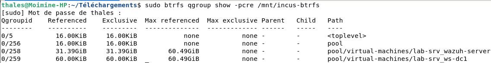

### Step 6.1.3 - Install the server

Inside the `wazuh-server` VM, I used the official all-in-one script:

```bash
curl -sO https://packages.wazuh.com/4.14/wazuh-install.sh
sudo bash ./wazuh-install.sh -a
```

At the end, the script prints the `admin` password for the dashboard. It also creates `wazuh-install-files.tar`, which contains all the generated passwords. I never publish it: it is listed in `.gitignore`, and none of my screenshots show a password.

The dashboard is available at `https://10.114.22.10`. To reach it from my host, I gave the host an address in VLAN 10 with a VLAN subinterface on the bridge:

```bash
sudo bridge vlan add dev lab-net1 vid 10 self
sudo ip link add link lab-net1 name lab-net1.10 type vlan id 10
sudo ip addr add 10.114.22.5/26 dev lab-net1.10
sudo ip link set lab-net1.10 up
```

I made this persistent by extending `lab-net1-vlan.service` (the systemd service from Phase 3 that enables VLAN filtering on `lab-net1` at boot) with these same commands, as extra `ExecStart=` lines run in order.

Config file: [`lab-net1-vlan.service`](configs/lab-net1-vlan.service)

### Step 6.1.4 - Open the firewall for the agent

The agent is in USERS and the server is in ADMIN, so the Phase 4 policy blocks the connection by default (USERS can only reach the DNS server in ADMIN). I added a narrow exception in the `forward` chain, only for the Wazuh server and only for its two ports:

```
iifname $USERS ip daddr $WAZUH tcp dport { 1514, 1515 } counter accept
```

Updated file: [`nftables.conf`](configs/nftables.conf)

### Step 6.1.5 - Install the agent

In the `linux-agent` container, I downloaded the `.deb` package and installed it with the manager address and an agent name:

```bash
WAZUH_MANAGER='10.114.22.10' WAZUH_AGENT_NAME='linux-agent' dpkg -i ./wazuh-agent_4.14.9-1_amd64.deb
systemctl daemon-reload
systemctl enable --now wazuh-agent
```

The agent appeared as **active** in the dashboard (`agent.id: 001`).

### Step 6.1.6 - Static addresses

Both machines got a DHCP reservation in Kea, matching their current lease, so they keep the same address across reboots: [`kea-dhcp4.conf`](configs/kea-dhcp4.conf)

### Step 6.1.7 - Proof that the traffic crosses the firewall

After the agent registered, I read the counter of the rule from the host:

```bash
incus exec router1 --project lab-srv -- nft list chain inet filter forward | grep 1514
```

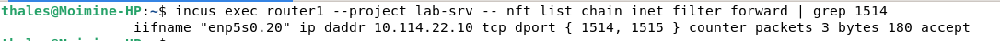

The counter shows **3 packets (180 bytes)**. It only counts the first packet of each connection (three SYN packets of 60 bytes): the rest of each connection is accepted earlier by the `ct state established,related` rule. So the agent really goes through the exception I wrote.

### Step 6.1.8 - Test 1: failed SSH logins

From inside `linux-agent`, I tried to log in 20 times with an account that does not exist:

```bash
for i in $(seq 10); do ssh -o BatchMode=yes -o StrictHostKeyChecking=no baduser@127.0.0.1; done
```

I ran the loop twice. Each attempt ends with `Permission denied`.

In the dashboard (Threat Hunting, filtered on `linux-agent`), I got **20 alerts**, all of type "Authentication failure", and none of level 12 or above:

| Alert | Level | Rule |
|---|---|---|
| `sshd: Attempt to login using a non-existent user` | 5 | 5710 |
| `sshd: brute force trying to get access to the system` | 10 | 5712 |

The level 5 rule fires on each attempt. The level 10 rule is a correlation: it fires when several failures happen in a short time. The alerts are also mapped to the PCI DSS requirements 10.2.4, 10.2.5, 10.6.1 and 11.4.

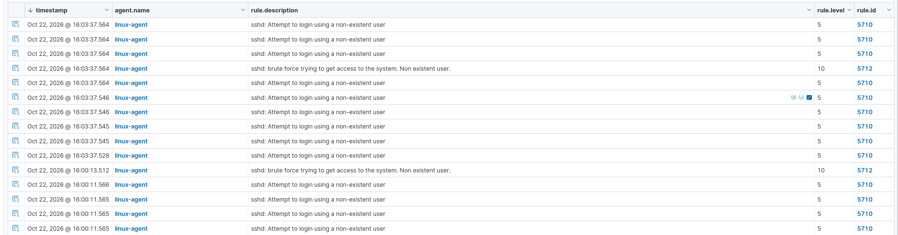

### Step 6.1.9 - Test 2: file integrity monitoring (FIM)

FIM watches a folder and reports every change. In `/var/ossec/etc/ossec.conf` of the agent, I added this line inside the `<syscheck>` block:

```xml
<directories check_all="yes" realtime="yes">/root/test-fim</directories>
```

Then I restarted the agent and waited for the log line `Real-time file integrity monitoring started`:

```bash
mkdir -p /root/test-fim
systemctl restart wazuh-agent
grep -i "real-time" /var/ossec/logs/ossec.log
```

Finally I created, modified and deleted a file:

```bash
echo "hello" > /root/test-fim/a.txt
echo "modifié" >> /root/test-fim/a.txt
rm /root/test-fim/a.txt
```

Wazuh reported the three events:

| Event | Rule | Level | Description |
|---|---|---|---|
| added | 554 | 5 | File added to the system. |
| modified | 550 | 7 | Integrity checksum changed. |
| deleted | 553 | 7 | File deleted. |

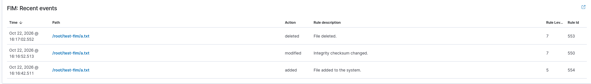

### Current limits (Wazuh)

- Only one agent is connected, and only Linux logs and FIM are used. There are no custom rules and no active response yet.
- No retention policy on the indexer yet; left unchecked, it will fill the disk again over time.

---

## Step 6.2 - Sysmon

## Step 6.3 - Suricata

## Step 6.4 - Suricata on Raspberry Pi

---

## Next

I plan to attack the lab from another machine (Phase 7) and check which of these actions Wazuh detects. Sysmon on a Windows endpoint and Suricata (including on the Raspberry Pi) are the next sub-phases to fill in.

# Phase 7 - Cyber Red Team (attack)

**Goal:** generate real attack traffic.

## Step 7.1 - Reconnaissance
## Step 7.2 - Cross-checking
## Step 7.3 - Exploitation and report

---

# Phase 8 - Moving to real hardware

**Hardware:** managed switch, router, Raspberry Pi.

## Step 9.1 - VLANs on the real switch
## Step 9.2 - Trunk (802.1Q)
## Step 9.3 - Router-on-a-stick
## Step 9.4 - ACLs on the real switch/router
## Step 9.5(optionnal) - Secure remote access (VPN)

---

# Phase 9 - HID injection

## Step 9.1 - Arduino: HID injection (BadUSB)

---

